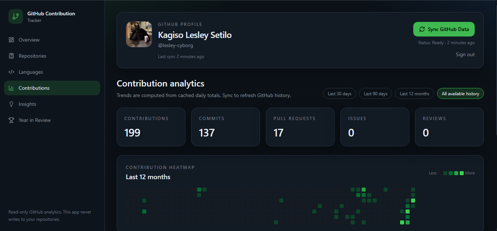
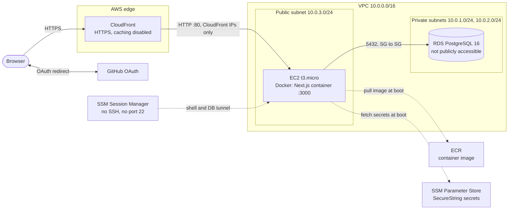
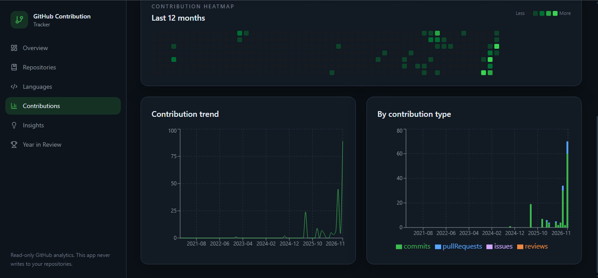
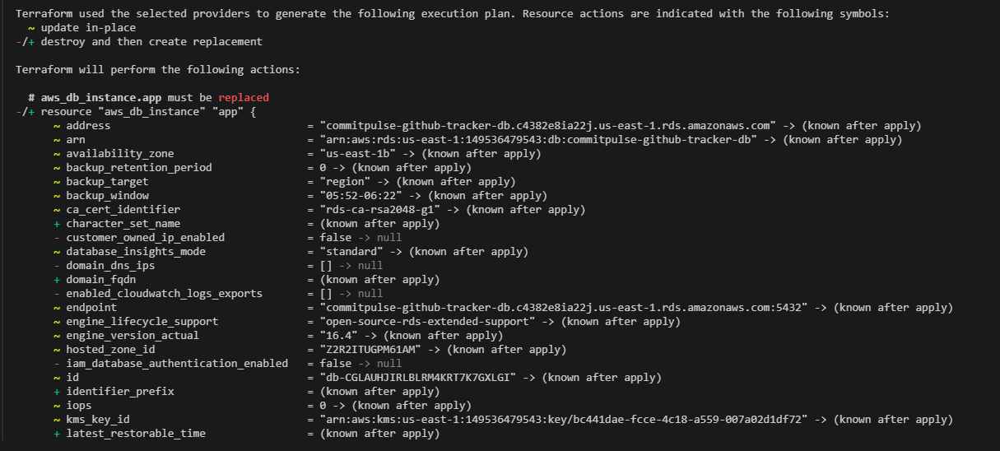
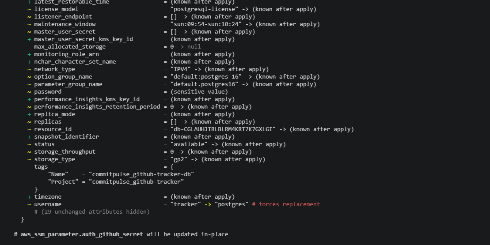
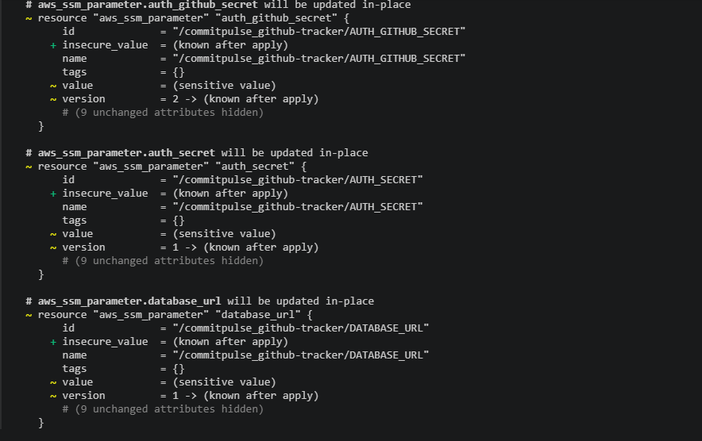

<div align="center">

# GitHub Contribution Tracker

**A GitHub analytics dashboard, deployed to AWS with Terraform.**
Sign in with GitHub, sync your activity, and explore commits, pull requests, languages, streaks and a yearly review.




</div>

---

## What this project is

Two things in one repository:

1. **The application:** a read-only dashboard that pulls your GitHub activity and turns it into stats: totals, streaks, per-repository and per-language breakdowns, and an application-generated *Contribution Score*. It never writes to your repositories.
2. **The infrastructure:** a complete, reproducible AWS deployment written in Terraform, built as a DevOps portfolio piece. The interesting part is the set of trade-offs behind it, which are documented in the [decision log](#decision-log) below, including the dead ends.

## Features

- GitHub OAuth sign-in (Auth.js v5) with database-backed sessions
- Overview, Repositories, Languages, Contributions, Insights and Year in Review views
- Manual sync of GitHub data into PostgreSQL via Drizzle ORM
- Container image built with a multi-stage Dockerfile and a distroless runtime

## Architecture



**Request path:** the browser talks HTTPS to CloudFront, which forwards every request (all headers, cookies and query strings, no caching) to the EC2 instance over HTTP on port 80. The container publishes port 3000 on that port, and talks to a private RDS instance over a security-group-scoped rule. Nothing but CloudFront can reach the instance, and nothing but the instance can reach the database.

**Boot path:** the instance's `user_data` installs Docker, authenticates to ECR with its instance role, pulls the image, reads the four secrets from SSM Parameter Store, writes them to a root-only env file, and starts the container.

## Tech stack

| Layer | Choice |
| --- | --- |
| App | Next.js 15 (App Router), Auth.js v5 (GitHub provider) |
| Data | PostgreSQL 16 on RDS, Drizzle ORM |
| Container | Multi-stage Docker build, `distroless/nodejs20-debian12` runtime |
| IaC | Terraform with the AWS provider `~> 5.0`, local state |
| Compute and edge | EC2 (Amazon Linux 2023), Elastic IP, CloudFront |
| Secrets and access | SSM Parameter Store, IAM instance profile, SSM Session Manager |

## Decision log

### Why EC2 + CloudFront, after App Runner failed

The first plan was AWS App Runner with a VPC connector: simple, managed and HTTPS out of the box. The apply failed with `SubscriptionRequiredException` because the account was on the Free Plan and the service wasn't available to it. Rather than upgrade the account, I pivoted.

GitHub OAuth requires an HTTPS callback URL, and an EC2 instance on its own only speaks HTTP. Putting **CloudFront** in front gives a free, AWS-managed `*.cloudfront.net` certificate without buying a domain or running a load balancer. EC2 + CloudFront is more to assemble than App Runner, but it exercises the primitives worth knowing: VPC routing, instance profiles, security groups and edge configuration.

### Why caching is disabled on CloudFront

The app is server-rendered and uses Auth.js session cookies. Caching HTML at the edge would risk serving one user's page to another, or silently breaking login. The distribution uses the AWS managed **`CachingDisabled`** cache policy and the **`AllViewer`** origin request policy, so all cookies, headers and query strings are forwarded to the origin.

### Why an Elastic IP

There is a dependency loop:

- CloudFront needs the origin's DNS name.
- The app needs the CloudFront domain in `AUTH_URL` at boot, or Auth.js builds the wrong callback URL.

A plain instance's public DNS only exists after it is created, which makes the cycle impossible to express in Terraform without a manual patch-the-env-file step. Allocating an **Elastic IP** first breaks the loop: the EIP's DNS name is known up front, so CloudFront points at it, and the instance is created afterwards with the real CloudFront domain baked into its environment. A side benefit is that the origin address survives instance stop and start.

### Why the CloudFront managed prefix list, not `0.0.0.0/0`

The instance's security group allows port 80 only from the AWS-managed prefix list `com.amazonaws.global.cloudfront.origin-facing`. Opening port 80 to the world would let anyone bypass CloudFront and hit the origin directly. Note that the prefix list covers *all* CloudFront tenants rather than just this distribution, and it counts as roughly 55 rules against the default 60-rule security group quota. See [known limitations](#known-limitations) for the stronger fix.

### Why the instance is public and the database is not

A NAT gateway costs money and an instance in a private subnet would need one (or VPC endpoints) to reach ECR and SSM. For a single-instance project, the cheaper trade is a public subnet for the instance, locked down with security groups, and private subnets for the database, which has no internet route at all.

### Why Amazon Linux 2023

Amazon Linux 2 has reached end of support. AL2023 ships with the AWS CLI and uses `dnf`. The AMI ID is resolved from the public SSM parameter, and `ignore_changes = [ami]` stops a new upstream AMI from replacing the instance on every plan.

## Security choices

| Control | What it does |
| --- | --- |
| **No SSH** | No port 22, no key pair. Shell access is via SSM Session Manager only. |
| **IMDSv2 required** | `http_tokens = "required"` with a hop limit of 1, so containers on the host cannot reach instance metadata. |
| **Least-privilege IAM** | The instance role can pull from *this* ECR repository only, and read *these four* SSM parameters only. No account-wide `AmazonSSMReadOnlyAccess`. |
| **Private database** | RDS is `publicly_accessible = false` in private subnets, reachable only from the instance's security group on 5432, with storage encryption on. |
| **Encrypted secrets** | Secrets are SSM `SecureString` parameters, read at boot into a `chmod 600` env file. |
| **Encrypted disks** | The instance root volume is encrypted. |
| **Locked-down origin** | Port 80 is reachable only from CloudFront origin-facing IPs. |
| **TLS to the database** | The boot script appends `sslmode=require` to the connection string if it is missing. |

### Running database migrations without opening the database

RDS has no public path, so migrations run from a laptop through an SSM port-forwarding session tunnelled via the instance:

```powershell
aws ssm start-session --region us-east-1 --target <instance-id> `
  --document-name AWS-StartPortForwardingSessionToRemoteHost `
  --parameters "host=<rds-endpoint>,portNumber=5432,localPortNumber=15432"

# in a second terminal, from the app root
$env:DATABASE_URL = "postgres://<user>:<password>@localhost:15432/<db>?sslmode=require"
npx drizzle-kit push
```

No inbound rule is opened for this, because the traffic rides the existing SSM channel.

## Known limitations

This is a portfolio and learning project, and these are the honest gaps:

- **Plaintext HTTP between CloudFront and the origin.** Viewer-to-CloudFront is HTTPS, but CloudFront-to-EC2 is HTTP over the public internet, including session cookies. Fixing it needs a custom domain with an ACM certificate (or an ALB) so the origin can serve TLS.
- **No custom domain.** The app is served from a `*.cloudfront.net` address, which is also why the origin cannot present a matching certificate.
- **Origin is not bound to this distribution.** The prefix list admits any CloudFront customer. A secret custom origin header, checked in Next.js middleware, would close this. The hook is stubbed in `phase3c.tf`.
- **Local Terraform state.** State lives in `terraform.tfstate` on one machine, with no locking. Secrets managed through Terraform also end up in that file, so it must stay out of git. The upgrade path is an S3 backend with locking and encryption.
- **Single instance, single AZ.** No autoscaling and no failover. Replacing the instance means downtime, and secrets are read only at boot, so a secret change needs the instance re-created (`terraform apply -replace=aws_instance.app`).
- **Manual deploys.** Shipping a new image means pushing to ECR and re-pulling on the instance. A CI/CD pipeline is the obvious next step.
- **Not literally free.** The sizes are free-tier eligible, but public IPv4 addresses are billed and Free Plan credits vary by account. Set an AWS Budget alert, and tear the stack down when you are done.

## Lessons learned

- **Check the account before the architecture.** App Runner failed at apply time on an account subscription issue, which no `terraform validate` would catch.
- **Deleting a Terraform block does not delete the thing.** After removing the old security group configuration, the AWS-side rule that referenced it stayed behind, and the connector security group could not be destroyed (`DependencyViolation`). The fix was to find the rule with `describe-security-group-rules` and revoke it by ID.
- **`docker restart` does not re-read `--env-file`.** The container must be recreated to pick up environment changes.
- **Silent tooling output is not success.** A `drizzle-kit` run that printed nothing had not applied anything. Verify by querying the database, not by the absence of an error.

## Getting started

### Prerequisites

- Node.js 20+, Docker, Terraform 1.0+, and the AWS CLI configured for your account
- The [Session Manager plugin](https://docs.aws.amazon.com/systems-manager/latest/userguide/session-manager-working-with-install-plugin.html) for the AWS CLI
- A [GitHub OAuth app](https://github.com/settings/developers)

### Run locally

```bash
npm install
cp .env.example .env     # DATABASE_URL, AUTH_SECRET, AUTH_GITHUB_ID, AUTH_GITHUB_SECRET
docker compose up --build
npx drizzle-kit push
npm run dev
```

For local development, set the OAuth app's callback URL to `http://localhost:3000/api/auth/callback/github`. A GitHub OAuth app allows only one callback URL, so use a separate OAuth app for local and deployed use.

### Deploy to AWS

1. Build and push the image to ECR (the repository is created by `terraform apply`, so apply once first, or create the repository, then push).
2. Provide secrets through a git-ignored `terraform.tfvars` (never commit it).
3. Apply:

   ```bash
   cd terraform
   terraform init
   terraform plan
   terraform apply
   ```

   CloudFront takes a few minutes to create.
4. Set the GitHub OAuth app's URLs from the Terraform outputs:

   ```bash
   terraform output github_oauth_callback_url
   terraform output github_oauth_homepage_url
   ```

5. Wait a few minutes for the instance to pull the image, run the [migration](#running-database-migrations-without-opening-the-database), then open the CloudFront URL.

If the site returns a 502, open a Session Manager session and check `sudo tail -50 /var/log/user-data.log` and `sudo docker logs tracker-app`.

### Tear down

```bash
terraform destroy
```

ECR will refuse to delete a repository that still holds images unless `force_delete = true` is set on it. CloudFront deletion takes several minutes. Afterwards, confirm in the console that no Elastic IP or RDS instance remains.

## Infrastructure layout

```
terraform/
├── main.tf         # provider, ECR repository + lifecycle policy (keep last 3 images)
├── phase3a.tf      # VPC, private subnets, security groups, RDS, SSM parameters
├── phase3c.tf      # IGW + public subnet, IAM, EC2 + EIP, CloudFront
├── variables.tf    # region, app name, database settings
└── outputs.tf      # ECR URL, RDS endpoint, CloudFront domain, OAuth URLs
```

## Screenshots

| Dashboard | Contributions |
| --- | --- |
|  |  |

| Terraform plan (1/3) | Terraform plan (2/3)  | Terraform plan (3/3) |
| --- | --- | --- |
|  |  |

|  |

## Roadmap

- [ ] CI/CD with GitHub Actions: build, push to ECR, roll the instance
- [ ] S3 remote state with locking
- [ ] Custom domain with ACM, TLS end to end
- [ ] Secret custom origin header enforced in middleware
- [ ] Move secrets to Terraform `sensitive` variables, then Secrets Manager with rotation
- [ ] Repeatable migration step in the pipeline

## License

MIT